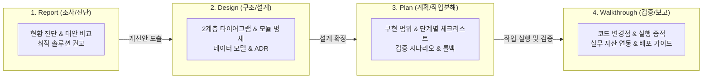

# 산출물 표준화 작성 가이드 (`artifact-standard`)

에이전트와의 협업, 기획, 검토, 분석, 설계 등 의사결정 프로세스에서 도출되는 모든 마크다운(`.md`) 산출물이 `00_artifacts/` 전용 저장소에서 일관된 품질, 구조적 무결성, 그리고 일련번호/버전 관리 표준을 갖추도록 지원하는 종합 산출물 거버넌스 스킬입니다.

---

## 1. 스킬 발동 기준 및 산출물 4대 생애주기 (Lifecycle Triggers)

에이전트는 다음 상황에서 **사용자의 명시적 요청이 있거나 자율적으로 산출물 작성이 필요하다고 판단될 때** 이 스킬을 활성화합니다:



1. **`Report` 작성 시점**: 신규 기술 도입 검토, 성능/메모리 병목 원인 진단, 장애 원인 사후 분석, 엔지니어링 대안 비교 평가 시.
2. **`Design` 작성 시점**: 시스템 아키텍처 및 데이터 파이프라인 신규 설계, 2계층 다이어그램 도식화, 모듈/API 및 데이터 모델 명세화 시.
3. **`Plan` 작성 시점**: 기능 구현 전 세부 작업 범위 설정, 체크리스트 분해, 리스크 및 롤백 전략 수립 시.
4. **`Walkthrough` 작성 시점**: 작업 완료 후 코드 변경점(Diff/Files) 정리, 테스트/솔버 실행 증적 확인, 실무 자산 연계 및 배포 주의사항 전달 시.

---

## 2. 템플릿 온디맨드 로딩 (Progressive Disclosure)

컨텍스트와 토큰을 낭비하지 않기 위해, **템플릿 전체를 시스템 프롬프트에 상주시키지 않고 필요한 시점에만 `read_file`로 온디맨드 로드**합니다:

| 산출물 유형 | 대상 디렉터리 (`00_artifacts/`) | 참조 템플릿 경로 |
| :--- | :--- | :--- |
| **Report (분석 리포트)** | `00_artifacts/reports/` | [`.agents/skills/artifact-standard/templates/template_report.md`](templates/template_report.md) |
| **Design (시스템/상세 설계서)** | `00_artifacts/designs/` | [`.agents/skills/artifact-standard/templates/template_design.md`](templates/template_design.md) |
| **Plan (구현 계획서)** | `00_artifacts/plans/` | [`.agents/skills/artifact-standard/templates/template_plan.md`](templates/template_plan.md) |
| **Walkthrough (완료 보고서)** | `00_artifacts/walkthroughs/` | [`.agents/skills/artifact-standard/templates/template_walkthrough.md`](templates/template_walkthrough.md) |

---

## 3. `template_design.md`를 참고한 시스템 설계 작업 지침 (Design Guidelines)

에이전트가 시스템, API, 데이터 파이프라인 설계를 수행할 때는 반드시 [`.agents/skills/artifact-standard/templates/template_design.md`](templates/template_design.md)를 온디맨드 로드하여 다음 5대 핵심 영역을 빠짐없이 기술해야 합니다:

### 1) 설계 개요 및 아키텍처 목표 (Section 1)
- **추진 배경 (Why)**: 왜 이 아키텍처/파이프라인이 필요한지, 기존 시스템(As-Is)의 병목이나 한계점을 명확히 정의합니다.
- **핵심 설계 원칙**: 확장성, 모듈성, 처리량, 지연 시간, 장애 복구 등 달성해야 할 비기능적 요구사항(NFR)을 3가지 이상 설정합니다.

### 2) 2계층 분리 다이어그램 작성 (Section 2)
복잡한 입출력과 내부 세부 연산을 하나의 다이어그램에 몰아넣어 선이 교차하거나 텍스트가 겹치는 안티패턴을 배제하고, 반드시 **2계층(Two-Level) 분리 원칙**을 적용합니다:

1. **Level 1. 시스템 전체 조망도 (Integration & Context View - `flowchart TD`)**:
   - 외부 유입 데이터(`Inputs`), 중앙 처리 코어(`Process`), 최종 산출물 및 영속화 스토리지(`Outputs`)를 각각의 서브그래프로 분리합니다.
   - 단계 간 전환 화살표는 내부 노드가 아닌 **서브그래프 ID 자체를 직접 연결**(`Inputs --> Process`, `Process --> Outputs`)합니다.
   - 표준 컬러 스타일(`inputStyle`, `coreStyle`, `outputStyle`)을 적용합니다.
2. **Level 2. 내부 세부 프로세스 흐름도 (Detailed Process Flow View - `flowchart TD`)**:
   - 외부 입출력 박스를 걷어내고 순수 내부 실행 파이프라인의 단계별 순차 작업, 병렬 처리, 검증 분기(`{...}`), 장애 롤백(`EndCancel`)을 표현합니다.
   - 서브그래프 제목은 반드시 **`Step NN: [핵심 역할/동사]`** 형식(한글 15~20자 이내)으로 압축하고 상세 설명은 내부 첫 번째 작업 노드로 위임합니다.
   - 메인 흐름 화살표는 단계 박스 전체를 직접 연결(`Start --> S1`, `S1 --> S2`, `S2 --> S3`, `P_Confirm -- "Yes" --> S4`)합니다.
3. **가독성 및 렌더링 안정성 4대 수칙**:
   - 노드 텍스트는 1줄당 한글 15~18자(영문 25~30자) 이내로 제한하고 의미 단위마다 `<br/>`를 강제 삽입합니다.
   - 특수문자, 태그, 줄바꿈이 들어간 모든 노드 텍스트는 큰따옴표(`"..."`)로 래핑합니다.
   - 마름모 분기 노드(`{...}`) 질문은 최대 10자 이내로 초압축합니다 (예: `{"검증 통과?"}`, `{"조건 충족?"}`).
   - 시맨틱 노드 형태: 시작/종료 `([ ... ])`, 단위작업 `[ ... ]`, 코어엔진 `[[ ... ]]`, 스토리지 `[( ... )]`, 조건분기 `{ ... }`.

### 3) 컴포넌트 및 인터페이스 상세 명세 (Section 3)
- 시스템을 구성하는 모듈/클래스의 **책임 매트릭스**를 표로 정의합니다.
- 모듈 간 호출 규격(함수 시그니처, 파라미터 타입, 리턴 타입) 또는 API 엔드포인트(URL, HTTP Method, Request/Response JSON Schema)를 코드 블록으로 구체화합니다.

### 4) 데이터 모델 및 스키마 설계 (Section 4)
- 시스템 내부에서 유통되는 데이터 구조체(Python `@dataclass` 또는 Pydantic Model), 데이터베이스 테이블 스키마, 또는 엔지니어링 경계조건/파라미터 매트릭스를 표 형태로 명세합니다.

### 5) 아키텍처 의사결정 기록 (ADR & Trade-offs, Section 5)
- 특정 아키텍처 패턴, 프레임워크, 라이브러리를 선정한 기술적 근거(Rationale)와 기각된 대안 대비 감수해야 할 트레이드오프(Consequences)를 명시하여 설계의 설득력을 높입니다.

---

## 4. 다이어그램 이미지 자산화 (`save_diagram_image.py`) 연계

설계서(`template_design.md`) 또는 계획서(`template_plan.md`)에 포함된 다이어그램은 실무 보존성과 고객 보고 편의를 위해 고해상도 이미지 파일로 내보낼 수 있습니다:

1. **저장 위치**: 실무 시각화 저장소인 [`02_output_data/01_figure/`](../../../02_output_data/01_figure)
2. **파일명 명명 규칙**: [`.agents/rules/file_naming.md`](../../rules/file_naming.md)에 따라 반드시 **`architecture_[일련번호]_([주제명])_[YYMMDD]_rev[NN].png`** 규격을 적용합니다.
3. **인덱스 자동 등록**: `save_diagram_image.py` 유틸리티를 실행하면 렌더링된 이미지가 저장됨과 동시에 [`02_output_data/README.md`](../../../02_output_data/README.md) 인덱스 테이블에 자동으로 등록됩니다.
4. **설계서 본문 링크 연결**: 설계서의 `Level 2` 다이어그램 상단/하단에 다음과 같이 링크를 삽입합니다:
   ```markdown
   📌 **[관련 아키텍처 다이어그램 자산]**: [architecture_001_([주제명])_[YYMMDD]_rev00.png](../../02_output_data/01_figure/architecture_001_([주제명])_[YYMMDD]_rev00.png)
   ```

---

## 5. 표준 양식 예외 처리 4대 수칙 (Graceful Degradation)

실무 작업의 규모, 긴급도, 환경적 제약에 따라 표준 양식을 문자 그대로 채우기 어려운 경우 다음 4대 원칙을 적용합니다:

1. **명시적 N/A(해당 없음) 및 사유 표기 (Section-level)**:
   - 특정 섹션(예: 다이어그램, ADR)이 작업 성격상 불필요할 때 헤더를 삭제하지 않고 사유를 명시합니다:
     ```markdown
     ## 2. 시스템 아키텍처 및 프로세스 흐름도 (Architecture & Workflow)
     > [!NOTE]  
     > 해당 없음 (N/A): 단순 오탈자 및 번역 리소스 수정으로 아키텍처 변경 수반되지 않음.
     ```
2. **Lightweight (Lite) 모드 지원 (Scale-level)**:
   - 긴급 핫픽스, 단순 오탈자 수정, 단일 파일 패치 등 S-size 소규모 작업 시:
   - 메타데이터에 `문서 모드: Lightweight (소규모 설계/패치)` 명시 후 핵심 섹션 위주로 축약 작성합니다.
3. **Draft / WIP 상태 플래그 (Timeline-level)**:
   - 시뮬레이션(CFD/FEM), 대규모 연산, 아키텍처 리뷰 대기 중인 경우:
   - 메타데이터에 `문서 상태: Draft (검토 중)` 표기 및 `<!-- TODO: 갱신 조건 -->` 처리 후 후속 갱신합니다.
4. **대체 증적(Alternative Evidence) 인정 (Environment-level)**:
   - 단위 테스트가 없는 환경일 경우 CLI 실행 터미널 출력문, 육안 검증 체크리스트, GUI 스크린샷(`02_output_data/01_figure/`)을 공식 증적으로 인정합니다.

---

## 6. 내장 유틸리티 CLI 실행 가이드

### 1) 산출물 원클릭 자동 생성 (`create_artifact.py`)
```bash
# 1. 신규 시스템 설계서 생성 (3자리 일련번호 자동 채번 및 rev00 기본 부여)
python .agents/skills/artifact-standard/scripts/create_artifact.py --type design --topic "data_pipeline" --desc "실시간 이벤트 파이프라인 설계서"

# 2. 신규 계획서 생성
python .agents/skills/artifact-standard/scripts/create_artifact.py --type plan --topic "data_pipeline" --desc "실시간 이벤트 파이프라인 구현 계획"

# 3. 기존 산출물의 리비전 업그레이드 생성 (예: 일련번호 001 유지, rev01 부여)
python .agents/skills/artifact-standard/scripts/create_artifact.py --type plan --topic "data_pipeline" --desc "실시간 이벤트 파이프라인 계획 (수정)" --seq 001 --rev 01

# 4. 신규 작업 완료 보고서 생성 (Lightweight 모드)
python .agents/skills/artifact-standard/scripts/create_artifact.py --type walkthrough --topic "login_hotfix" --desc "로그인 세션 예외 패치" --lite

# 5. 신규 분석 리포트 생성
python .agents/skills/artifact-standard/scripts/create_artifact.py --type report --topic "orm_performance" --desc "JPA N+1 쿼리 병목 진단"
```

### 2) 다이어그램 이미지 내보내기 및 자산화 (`save_diagram_image.py`)
```bash
# 1. 파일에 작성된 Mermaid 다이어그램을 PNG로 내보내기 (02_output_data/01_figure/ 자동 저장 및 인덱스 동기화)
python .agents/skills/artifact-standard/scripts/save_diagram_image.py --topic "order_flow" --desc "주문 처리 프로세스 흐름도" --code-file "path/to/diagram.mmd"

# 2. 인라인 코드로 아키텍처 다이어그램 내보내기 (기본 태그: architecture)
python .agents/skills/artifact-standard/scripts/save_diagram_image.py --topic "order_flow" --desc "주문 처리 프로세스 흐름도" --code "flowchart TD..."

# 3. 일반 플롯 또는 이미지 태그로 내보내기
python .agents/skills/artifact-standard/scripts/save_diagram_image.py --topic "mesh_overview" --tag image --desc "격자망 개요도" --code "..."
```
