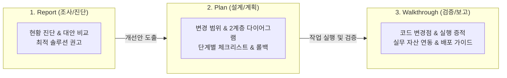

# 산출물 표준화 작성 가이드 (`artifact-standard`)

에이전트와의 협업, 기획, 검토, 분석, 설계 등 의사결정 프로세스에서 도출되는 모든 마크다운(`.md`) 산출물이 `00_artifacts/` 전용 저장소에서 일관된 품질, 구조적 무결성, 그리고 일련번호/버전 관리 표준을 갖추도록 지원하는 스킬입니다.

---

## 1. 스킬 발동 기준 및 생애주기 (Lifecycle Triggers)

에이전트는 다음 상황에서 **사용자의 명시적 요청이 있거나 자율적으로 산출물 작성이 필요하다고 판단될 때** 이 스킬을 활성화합니다:



1. **`Report` 작성 시점**: 신규 기술 도입 검토, 성능/메모리 병목 원인 진단, 장애 원인 사후 분석, 엔지니어링 대안 비교 평가 시.
2. **`Plan` 작성 시점**: 기능 구현 전 작업 범위 설정, 3단계 이상의 복잡한 로직/파이프라인 설계, 리스크 및 롤백 전략 수립 시.
3. **`Walkthrough` 작성 시점**: 작업 완료 후 코드 변경점(Diff/Files) 정리, 테스트/솔버 실행 증적 확인, 실무 자산 연계 및 배포 주의사항 전달 시.

---

## 2. 템플릿 온디맨드 로딩 (Progressive Disclosure)

컨텍스트와 토큰을 낭비하지 않기 위해, **템플릿 전체를 시스템 프롬프트에 상주시키지 않고 필요한 시점에만 `read_file`로 온디맨드 로드**합니다:

| 산출물 유형 | 대상 디렉터리 (`00_artifacts/`) | 참조 템플릿 경로 |
| :--- | :--- | :--- |
| **Plan (구현 계획서)** | `00_artifacts/plans/` | [`.agents/skills/artifact-standard/templates/template_plan.md`](templates/template_plan.md) |
| **Walkthrough (완료 보고서)** | `00_artifacts/walkthroughs/` | [`.agents/skills/artifact-standard/templates/template_walkthrough.md`](templates/template_walkthrough.md) |
| **Report (분석 리포트)** | `00_artifacts/reports/` | [`.agents/skills/artifact-standard/templates/template_report.md`](templates/template_report.md) |

---

## 3. 통합 파일명 명명 규칙: 일련번호 및 버전 관리 표준

`init-env` 스킬의 워크스페이스 표준에 따라, 대량 파일 생성 시에도 순서와 버전을 명확히 파악할 수 있도록 **3자리 일련번호(`NNN`)**와 **리비전(`revNN`)**을 예외 없이 필수로 결합합니다:

- **표준 템플릿**:
  ```text
  [포맷태그]_[일련번호]_([주제명])_[YYMMDD]_rev[NN].[확장자]
  ```

### 6대 필수 준수 수칙:
1. **구분자**: 하이픈(`-`) 사용 절대 금지, **언더스코어(`_`)만 반드시 사용**합니다.
2. **포맷 태그(`[포맷태그]`)**:
   - `00_artifacts/` 산출물: `plan`, `walkthrough`, `report`, `design`
   - `01_input_data/`, `02_output_data/`, `03_scripts/` 실무 자산: `excel`, `csv`, `plot`, `image`, `architecture`, `log`, `doc`, `ppt`, `pdf`, `py`, `jou`, `sh`
   > [!IMPORTANT]
   > 아키텍처 다이어그램을 작성한 뒤 사용자의 요청으로 이미지 파일로 저장해야 되는 경우, 포맷태그를 반드시 **`architecture`**로 지정합니다. (예: `architecture_001_([주제명])_[YYMMDD]_rev00.png`)
3. **일련번호(`[일련번호]`)**: 포맷별 **3자리 문서번호/생성 순번 (`001`, `002`, ... `999`)**. 생성 순서대로 탐색기 자동 정렬을 지원합니다.
4. **괄호 표기(`([주제명])`)**: 파일명 내의 `[주제명]` 부분은 반드시 소괄호 `(` 와 `)` 로 직접 감쌉니다.
5. **날짜 표기(`[YYMMDD]`)**: 6자리 숫자 (예: 2026년 10월 28일 ➔ `261028`).
6. **버전 표기(`rev[NN]`)**:
   - **최초 생성 시 무조건 `rev00` 기본 부여**
   - 동일 파일/주제 내용 갱신 시 **`rev01`**, **`rev02`**로 번호를 증가시켜 이력을 추적합니다.

### 명명 예시:
- 최초 계획서 생성: `00_artifacts/plans/plan_001_(battery_cooling)_261028_rev00.md`
- 계획서 내용 수정: `00_artifacts/plans/plan_001_(battery_cooling)_261028_rev01.md`
- 차기 계획서 생성: `00_artifacts/plans/plan_002_(motor_thermal)_261028_rev00.md`
- 완료 보고서 생성: `00_artifacts/walkthroughs/walkthrough_001_(battery_cooling)_261028_rev00.md`
- 분석 리포트 생성: `00_artifacts/reports/report_001_(orm_performance)_261028_rev00.md`
- **아키텍처 다이어그램 이미지 저장**: `02_output_data/01_figure/architecture_001_(system_architecture)_261028_rev00.png`

---

## 4. 표준 양식 예외 처리 4대 수칙 (Graceful Degradation)

실무 작업의 규모, 긴급도, 환경적 제약에 따라 표준 양식을 문자 그대로 채우기 어려운 경우 다음 4대 원칙을 적용합니다:

1. **명시적 N/A(해당 없음) 및 사유 표기 (Section-level)**:
   - 특정 섹션(예: 다이어그램, 롤백 전략)이 작업 성격상 불필요할 때, **헤더를 임의 삭제하지 않고** 사유를 명시합니다:
     ```markdown
     ## 3. 아키텍처 및 작업 흐름도 (Architecture & Workflow)
     > [!NOTE]  
     > 해당 없음 (N/A): 단순 오탈자 및 번역 리소스 수정으로 아키텍처 변경 수반되지 않음.
     ```
2. **Lightweight (Lite) 모드 지원 (Scale-level)**:
   - 긴급 핫픽스, 단순 오탈자 수정, 단일 파일 패치 등 S-size 소규모 작업 시:
   - 메타데이터에 `문서 모드: Lightweight (소규모 패치)` 명시 후, **핵심 4개 섹션(메타데이터, 개요, 변경 파일, 검증 결과)**으로 축약 작성합니다.
3. **Draft / WIP 상태 플래그 (Timeline-level)**:
   - 시뮬레이션(CFD/FEM), 대규모 배치 연산, 배포 대기로 최종 수치가 나오지 않은 경우:
   - 메타데이터에 `문서 상태: Draft (진행 중)` 표기 및 `<!-- TODO: 갱신 조건 -->` 처리 후 후속 갱신합니다.
4. **대체 증적(Alternative Evidence) 인정 (Environment-level)**:
   - 자동화 단위 테스트(`pytest`, `jest`)가 없는 환경인 경우:
   - CLI 수동 실행 터미널 출력문, 육안 검증 체크리스트, GUI 스크린샷(`02_output_data/01_figure/`)을 공식 증적으로 인정합니다.

---

## 5. 연계 수칙: 시각화 및 5대 번호형 저장소 분리

1. **`diagram-standard` 스킬 필수 준수 및 아키텍처 이미지 포맷태그**:
   - 아키텍처 다이어그램 작성 시 반드시 **Level 1 전체 조망도(TD) + Level 2 세부 흐름도(TD)** 2계층 분리 원칙을 적용합니다.
   - 아키텍처 다이어그램을 작성한 뒤 **사용자의 요청으로 이미지 파일로 저장해야 되는 경우, 포맷태그는 반드시 `architecture`로 지정**하여 저장합니다:
     - 저장 경로: `02_output_data/01_figure/architecture_[일련번호]_([주제명])_[YYMMDD]_rev[NN].png`
     - 예시: `02_output_data/01_figure/architecture_001_(cloud_data_pipeline)_261028_rev00.png`
   - 그 외 일반 시각화 플롯이나 차트 이미지는 `plot` 또는 `image` 태그를 사용합니다.
2. **대형 데이터의 실무 자산 분리 (`02_output_data/`)**:
   - 100줄 이상의 대형 데이터나 복잡한 표, 시각화, 최종 보고서는 마크다운 본문에 직접 넣지 않고 작업 흐름 3단계 저장소(`02_output_data/`)에 분리 보관한 뒤 링크합니다:
     - **1단계 수치 데이터 (`02_output_data/00_data/`)**: `csv_001_([주제명])_[YYMMDD]_rev00.csv`, `excel_001_([주제명])_[YYMMDD]_rev00.xlsx`
     - **2단계 시각화/로그 (`02_output_data/01_figure/`)**:
       - 아키텍처 다이어그램 이미지: `architecture_001_([주제명])_[YYMMDD]_rev00.png`
       - 시각화 플롯/이미지: `plot_001_([주제명])_[YYMMDD]_rev00.png`, `image_001_([주제명])_[YYMMDD]_rev00.png`
       - 솔버 실행 로그: `log_001_([주제명])_[YYMMDD]_rev00.trn`
     - **3단계 최종 보고서 (`02_output_data/02_reports/`)**: `doc_001_([주제명])_[YYMMDD]_rev00.docx`, `ppt_001_([주제명])_[YYMMDD]_rev00.pptx`, `pdf_001_([주제명])_[YYMMDD]_rev00.pdf`

---

## 6. 원클릭 자동 생성 유틸리티 (`create_artifact.py`)

에이전트나 작업자는 일련번호 자동 채번, 리비전 부여, 파일 생성 및 인덱스 등록을 원클릭으로 수행할 수 있습니다.

### 사용법 및 CLI 커맨드
```bash
# 1. 신규 계획서 생성 (3자리 일련번호 자동 채번 및 rev00 기본 부여)
python .agents/skills/artifact-standard/scripts/create_artifact.py --type plan --topic "battery_cooling" --desc "배터리 냉각 최적화 계획"

# 2. 기존 계획서의 리비전 업그레이드 생성 (예: 일련번호 001 유지, rev01 부여)
python .agents/skills/artifact-standard/scripts/create_artifact.py --type plan --topic "battery_cooling" --desc "배터리 냉각 최적화 계획 (수정)" --seq 001 --rev 01

# 3. 신규 작업 완료 보고서 생성 (Lightweight 모드)
python .agents/skills/artifact-standard/scripts/create_artifact.py --type walkthrough --topic "login_hotfix" --desc "로그인 세션 널포인터 예외 패치" --lite

# 4. 신규 분석 리포트 생성
python .agents/skills/artifact-standard/scripts/create_artifact.py --type report --topic "orm_performance" --desc "JPA 대용량 쿼리 N+1 문제 진단"
```

* **동작 흐름**:
  1. 대상 폴더(`00_artifacts/[카테고리]s/`)를 스캔하여 다음 3자리 일련번호(`001`~`999`)를 자동 산출하고 표준 명명 규격 `[포맷태그]_[일련번호]_([주제명])_[YYMMDD]_rev[NN].md`를 조합합니다.
  2. 대상 템플릿을 `00_artifacts/[카테고리]s/`에 복사하고 작성일자 및 메타데이터를 자동 치환합니다.
  3. [`00_artifacts/README.md`](file:///c:/work_dir/my_agy/00_artifacts/README.md) 인덱스 테이블을 파싱하여 신규 행을 자동 등록합니다.
