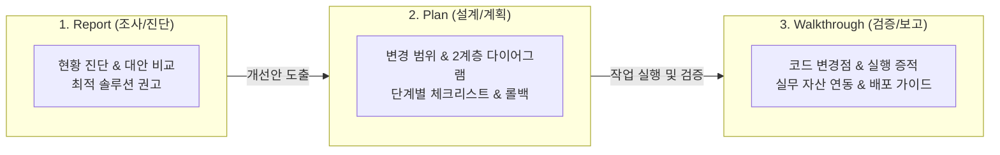

# 산출물 표준화 작성 가이드 (`artifact-standard`)

에이전트와의 협업, 기획, 검토, 분석, 설계 등 의사결정 프로세스에서 도출되는 모든 마크다운(`.md`) 산출물이 일관된 품질과 구조적 무결성을 갖추도록 지원하는 표준 스킬입니다.

---

## 1. 스킬 발동 기준 및 생애주기 (Lifecycle Triggers)

에이전트는 다음 상황에서 **사용자의 명시적 요청이 있거나 자율적으로 산출물 작성이 필요하다고 판단될 때** 이 스킬을 활성화합니다:



1. **`Report` 작성 시점**: 신규 기술 도입 검토, 성능/메모리 병목 원인 진단, 장애 원인 사후 분석, 아키텍처 대안 비교 평가 시.
2. **`Plan` 작성 시점**: 기능 구현 전 작업 범위 설정, 3단계 이상의 복잡한 로직 설계, 리스크 및 롤백 전략 수립 시.
3. **`Walkthrough` 작성 시점**: 작업 완료 후 코드 변경점(Diff/Files) 정리, 테스트 커맨드 및 실행 증적 확인, 배포 주의사항 전달 시.

---

## 2. 템플릿 온디맨드 로딩 (Progressive Disclosure)

컨텍스트와 토큰을 낭비하지 않기 위해, **템플릿 전체를 시스템 프롬프트에 상주시키지 않고 필요한 시점에만 `view_file`로 온디맨드 로드**합니다:

| 산출물 유형 | 대상 디렉터리 | 참조 템플릿 경로 |
| :--- | :--- | :--- |
| **Plan (구현 계획서)** | `artifacts/plans/` | [`.agents/skills/artifact-standard/templates/template_plan.md`](templates/template_plan.md) |
| **Walkthrough (완료 보고서)** | `artifacts/walkthroughs/` | [`.agents/skills/artifact-standard/templates/template_walkthrough.md`](templates/template_walkthrough.md) |
| **Report (분석 리포트)** | `artifacts/reports/` | [`.agents/skills/artifact-standard/templates/template_report.md`](templates/template_report.md) |

---

## 3. 표준 양식 예외 처리 4대 수칙 (Graceful Degradation)

실무 작업의 규모, 긴급도, 환경적 제약에 따라 표준 양식을 문자 그대로 채우기 어려운 경우 다음 4대 원칙을 적용합니다:

1. **명시적 N/A(해당 없음) 및 사유 표기 (Section-level)**:
   - 특정 섹션(예: 다이어그램, 롤백 전략)이 작업 성격상 불필요할 때, **헤더를 임의 삭제하지 않고** 사유를 명시합니다:
     ```markdown
     ## 3. 아키텍처 및 작업 흐름도 (Architecture & Workflow)
     > [!NOTE]  
     > 해당 없음 (N/A): 단순 오탈자 및 번역 리소스 수정으로 아키텍처 변경 수반되지 않음.
     ```
2. **Lightweight (Lite) 모드 지원 (Scale-level)**:
   - 긴급 핫픽스, 단순 오탈자 수정, 단일 파일 패치 등 S-size 소규모 작업 시:
   - 메타데이터에 `문서 모드: Lightweight (소규모 패치)` 명시 후, **핵심 4개 섹션(메타데이터, 개요, 변경 파일, 검증 결과)**으로 축약 작성합니다.
3. **Draft / WIP 상태 플래그 (Timeline-level)**:
   - 시뮬레이션(CFD/FEM), 대규모 배치 연산, 배포 대기로 최종 수치가 나오지 않은 경우:
   - 메타데이터에 `문서 상태: Draft (진행 중)` 표기 및 `<!-- TODO: 갱신 조건 -->` 처리 후 후속 갱신합니다.
4. **대체 증적(Alternative Evidence) 인정 (Environment-level)**:
   - 자동화 단위 테스트(`pytest`, `jest`)가 없는 환경인 경우:
   - CLI 수동 실행 터미널 출력문, 육안 검증 체크리스트, GUI 스크린샷([`agy_outputs/images/`](file:///c:/work_dir/my_agy/agy_outputs/images))을 공식 증적으로 인정합니다.

---

## 4. 연계 수칙: 시각화 및 실무 자료 분리

1. **`diagram-standard` 스킬 필수 준수**:
   - 아키텍처 다이어그램 작성 시 반드시 **Level 1 전체 조망도(LR) + Level 2 세부 흐름도(TD)** 2계층 분리 원칙을 적용합니다.
   - 고해상도 이미지로 내보낼 경우 `save_diagram_image.py`를 실행하여 [`agy_outputs/images/`](file:///c:/work_dir/my_agy/agy_outputs/images)에 저장합니다.
2. **대형 데이터의 실무 자산 분리 (`agy_outputs/`)**:
   - 100줄 이상의 대형 데이터나 복잡한 표는 본문에 직접 넣지 않고, [`agy_outputs/csv/`](file:///c:/work_dir/my_agy/agy_outputs/csv), [`excel/`](file:///c:/work_dir/my_agy/agy_outputs/excel), [`plots/`](file:///c:/work_dir/my_agy/agy_outputs/plots)에 파일로 저장한 뒤 링크합니다.

---

## 5. 원클릭 자동 생성 유틸리티 (`create_artifact.py`)

에이전트나 작업자는 파일 생성 및 인덱스 등록을 원클릭으로 수행할 수 있습니다.

### 사용법 및 CLI 커맨드
```bash
# 1. 신규 계획서 생성 및 artifacts/README.md 인덱스 자동 등록
python .agents/skills/artifact-standard/scripts/create_artifact.py --type plan --topic "battery_cooling" --desc "배터리 냉각 최적화 계획"

# 2. 신규 작업 완료 보고서 생성 (Lightweight 모드)
python .agents/skills/artifact-standard/scripts/create_artifact.py --type walkthrough --topic "login_hotfix" --desc "로그인 세션 널포인터 예외 패치" --lite

# 3. 신규 분석 리포트 생성
python .agents/skills/artifact-standard/scripts/create_artifact.py --type report --topic "orm_performance" --desc "JPA 대용량 쿼리 N+1 문제 진단"
```

* **동작 흐름**:
  1. 표준 명명 규격 `[카테고리]_([주제명])_[YYMMDD].md` 자동 조합
  2. 대상 템플릿을 `artifacts/[카테고리]s/`에 복사하고 작성일자 자동 치환
  3. [`artifacts/README.md`](file:///c:/work_dir/my_agy/artifacts/README.md) 인덱스 테이블 파싱 및 신규 행 자동 등록
