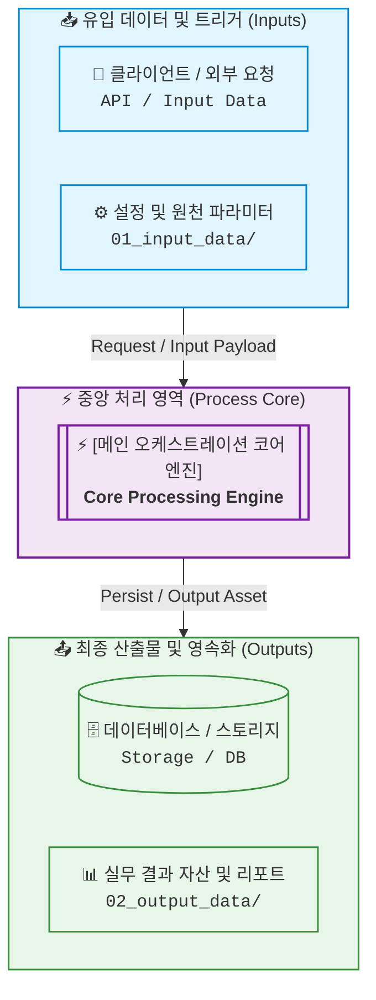
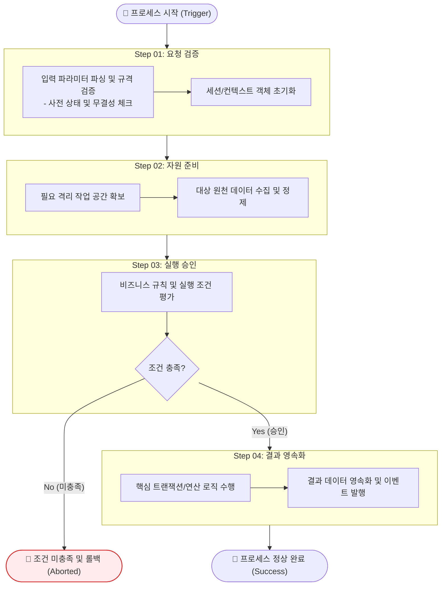

# [Design] [시스템/파이프라인 설계 주제명을 명사형으로 명확히 작성]

> **문서 메타데이터**  
> - **작성일**: YYYY-MM-DD | **작성자**: [작성자/에이전트명 (@architect)]  
> - **연관 산출물**: [선행 Report 또는 후속 Plan 링크]  
> - **설계 대상 범위**: [대상 시스템, 모듈, 데이터 파이프라인 영역]  
> - **문서 모드**: Standard (전체 설계) <!-- 또는 Lightweight (소규모 설계) -->  
> - **문서 상태**: Final (확정) <!-- 또는 Draft (검토 중) -->

---

## 1. 설계 개요 및 아키텍처 목표 (Design Overview & Goals)
*이 시스템/파이프라인을 왜 설계하며, 달성해야 할 핵심 구조적 목표와 제약 조건을 정의합니다.*

### 1) 설계 배경 및 해결 과제 (Context & Problem)
- [기존 구조의 한계점 또는 신규 구축이 필요한 엔지니어링 배경]

### 2) 핵심 설계 원칙 및 비기능적 요구사항 (Design Principles)
1. **확장성/모듈성**: [핵심 원칙 1]
2. **성능/처리량 목표**: [핵심 원칙 2]
3. **안정성/예외 복구**: [핵심 원칙 3]

---

## 2. 시스템 아키텍처 및 프로세스 흐름도 (2-Level Diagrams)
*복잡한 입출력과 다단계 작업을 단일 그림에 섞지 않고 반드시 **Level 1(전체 조망도)**과 **Level 2(세부 흐름도)** 2계층으로 분리하여 작성합니다.*
<!-- 
[다이어그램 작성 필수 수칙 요약]
1. 노드 텍스트: 1줄당 한글 15~18자(영문 25~30자) 이내 제한, 의미 단위마다 <br/> 명시, 반드시 큰따옴표("...")로 래핑.
2. 마름모 분기 노드({...}): 1~2개 핵심 어절(최대 10자 이내)로 초압축 (예: {"검증 통과?"}).
3. 서브그래프(단계 박스) 제목: 반드시 "Step NN: [핵심 역할/동사]" 형식(한글 15~20자 이내)으로 작성하고 상세 설명은 내부 첫 번째 노드로 이관.
4. 서브그래프 타깃팅 연결: 단계 간 화살표는 내부 세부 노드가 아닌 서브그래프 ID 자체를 직접 연결 (Inputs --> Process, S1 --> S2).
5. 시맨틱 노드 모양: ([시작/종료]), [단위 작업], [[코어 엔진]], [(DB/스토리지)], {조건 분기}.
-->

### Level 1. 시스템 전체 조망도 (Integration & Context View)
*외부 유입 데이터(Inputs), 중앙 처리 코어(Process), 최종 산출물/저장소(Outputs) 간의 거시적 인터페이스를 표현합니다.*



### Level 2. 내부 세부 프로세스 흐름도 (Detailed Process Flow View)
*외부 I/O 박스를 제거하고 내부 실행 파이프라인의 단계별 작업(`Step NN`), 검증 분기, 롤백 흐름을 표현합니다.*
<!-- 고해상도 이미지 자산 저장 시 링크: [architecture_001_([주제명])_[YYMMDD]_rev00.png](../../02_output_data/01_figure/architecture_001_([주제명])_[YYMMDD]_rev00.png) -->



---

## 3. 컴포넌트 및 인터페이스 상세 명세 (Component & Interface Specs)
*시스템을 구성하는 개별 모듈의 책임과 입출력 인터페이스(API, CLI, 함수 시그니처)를 정의합니다.*

### 1) 핵심 컴포넌트 역할 매트릭스
| 컴포넌트 / 모듈명 | 파일/패키지 경로 | 핵심 역할 및 책임 (Responsibility) | 의존성 (Dependencies) |
| :--- | :--- | :--- | :--- |
| `[ModuleA]` | `path/to/module_a.py` | [입력 데이터 파싱 및 스키마 검증] | `pydantic`, `pathlib` |
| `[CoreEngine]` | `path/to/engine.py` | [핵심 도메인 연산 및 파이프라인 조율] | `ModuleA`, `Storage` |

### 2) 인터페이스 및 입출력 규격 (API / CLI / Function Signature)
```python
# 핵심 인터페이스 시그니처 또는 API 엔드포인트 명세 예시
def execute_pipeline(input_path: Path, config: PipelineConfig) -> PipelineResult:
    """Brief docstring in English describing the contract."""
    ...
```

---

## 4. 데이터 모델 및 스키마 설계 (Data Model & Schema)
*정형 데이터 구조체(`@dataclass`), DB 테이블 스키마 또는 시뮬레이션 격자/경계조건 파라미터를 정의합니다.*

| 필드 / 파라미터명 | 데이터 타입 | 필수 여부 | 기본값 | 상세 설명 및 제약 조건 |
| :--- | :---: | :---: | :---: | :--- |
| `target_id` | `str` | Y | - | 대상 식별자 (`snake_case`) |
| `max_retries` | `int` | N | `3` | 최대 재시도 횟수 (`1~10`) |

---

## 5. 아키텍처 의사결정 기록 및 트레이드오프 (ADR & Trade-offs)
*설계 과정에서 검토한 대안들과 최종 채택한 설계 방식의 근거를 기록합니다.*

- **결정 사항 (Decision)**: [채택한 구조 또는 기술 방식]
- **선정 근거 (Rationale)**: [채택 이유 — 단순성, 성능, 호환성 등]
- **트레이드오프 및 제약 (Consequences)**: [감수해야 할 단점 및 완화 방안]
