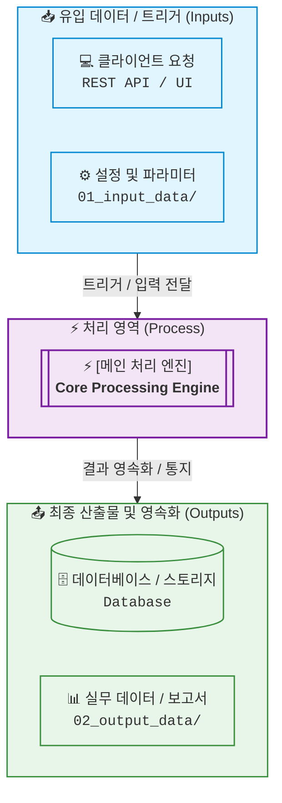
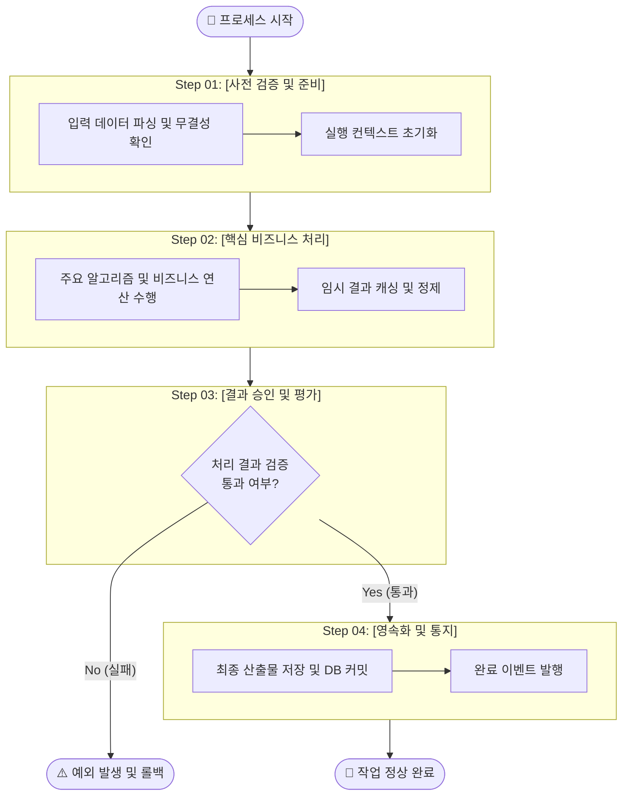

# [Plan] [구현/설계 주제명을 명사형으로 명확히 작성]

> **문서 메타데이터**  
> - **작성일**: YYYY-MM-DD | **작성자**: [작성자/에이전트명]  
> - **연관 산출물**: [선행 Report 링크(예: report_001_([주제명])_[YYMMDD]_rev00.md) 또는 관련 이슈 번호]  
> - **예상 범위**: [영향받는 모듈, 디렉터리, 패키지 영역]  
> - **문서 모드**: Standard (전체 계획) <!-- 또는 Lightweight (소규모 계획) -->  
> - **문서 상태**: Final (확정) <!-- 또는 Draft (검토 중) -->

---

## 1. 개요 및 구현 목표 (Why & Goals)
*이 작업을 왜 수행하는지, 최종적으로 무엇을 달성해야 완료인지 명확히 정의합니다.*

### 1) 추진 배경 (Why)
- [작업이 필요한 근본적인 이유 및 해결하려는 요구사항]

### 2) 핵심 구현 목표 (Goals)
1. [핵심 달성 목표 1]
2. [핵심 달성 목표 2]
3. [핵심 달성 목표 3]

### 3) 완료 정의 (Definition of Done)
- [ ] [주요 기능 또는 파이프라인 구현 완료]
- [ ] [단위 테스트 및 통합 테스트 통과]
- [ ] [성능 기준 또는 비기능적 요구사항 충족]
- [ ] [작업 완료 보고서(walkthrough) 작성 완료]

---

## 2. 변경 범위 및 리스크 분석 (Scope & Risk)
*작업으로 인해 영향받는 시스템 영역을 식별하고, 실패 시의 방어 대책을 수립합니다.*

### 1) 영향 범위 매트릭스
| 대상 모듈/파일 | 변경 유형 (신규/수정/삭제) | 위험도 (상/중/하) | 주요 변경 내용 |
| :--- | :--- | :--- | :--- |
| `path/to/module_a.py` | 수정 | 중 | [핵심 로직 변경 내용] |
| `path/to/new_module.py` | 신규 | 하 | [신규 컴포넌트 추가] |

### 2) 잠재 위험 및 롤백 전략 (Rollback Plan)
> [!WARNING]  
> **롤백 실행 방안 (Fallback Strategy)**:  
> - **장애 감지 기준**: [배포/적용 후 어떤 현상이 나타나면 롤백할 것인가?]  
> - **복구 절차**:  
>   1. Git 롤백: `git revert <commit_hash>` 또는 브랜치 롤백  
>   2. 설정/데이터 복구: [DB 마이그레이션 다운그레이드 또는 이전 설정값 복구 명령어]

---

## 3. 아키텍처 및 작업 흐름도 (Architecture & Workflow)
*`artifact-standard`(또는 `template_design.md`) 표준에 따라 Level 1 조망도와 Level 2 세부 흐름도를 2계층으로 분리하여 작성합니다.*

### Level 1. 시스템 전체 조망도 (Integration View)
*외부 입출력 소스와 처리 시스템 간의 거시적 관계를 표현합니다.*



### Level 2. 내부 세부 프로세스 흐름도 (Detailed Process Flow)
*단계별 내부 작업 파이프라인과 조건 분기를 표현합니다. (서브그래프 ID 직접 연결 수칙 준수)*
<!-- 렌더링된 고해상도 이미지 자산이 있을 경우 링크: 02_output_data/01_figure/image_001_([주제명])_[YYMMDD]_rev00.png -->



---

## 4. 세부 구현 단계 (Task Breakdown)
*에이전트 또는 엔지니어가 체크리스트 기반으로 순차 실행할 상세 작업 목록입니다.*

- [ ] **Step 01: [사전 준비 및 기반 작업]**
  - [ ] `path/to/config.py`: [환경설정 또는 인터페이스 정의]
  - [ ] `path/to/dto.py`: [데이터 모델 선언]
- [ ] **Step 02: [핵심 비즈니스 로직 구현]**
  - [ ] `path/to/service.py`: [`CoreService` 클래스 및 핵심 메서드 구현]
- [ ] **Step 03: [예외 처리 및 방어 코드 적용]**
  - [ ] `path/to/handler.py`: [오류 핸들러 및 롤백 보상 트랜잭션 추가]
- [ ] **Step 04: [작업 검증 및 완료 보고서 작성]**
  - [ ] 단위 테스트 작성 및 통과 검증
  - [ ] 작업 완료 보고서 작성: `00_artifacts/walkthroughs/walkthrough_001_([주제명])_[YYMMDD]_rev00.md`

---

## 5. 검증 및 테스트 계획 (Verification Plan)
*구현된 결과물이 의도대로 동작하는지 입증하기 위한 검증 시나리오입니다.*

### 1) 자동화 테스트 커맨드
```bash
# 단위 테스트 실행 명령어
pytest tests/unit/test_feature.py -v

# 통합/E2E 테스트 실행 명령어
pytest tests/integration/test_feature.py -v
```

### 2) 수동 검증 및 엣지 케이스 시나리오
| 번호 | 검증 시나리오 | 입력 조건 / 실행 절차 | 기대 결과 | 판정 기준 |
| :---: | :--- | :--- | :--- | :--- |
| 1 | 정상 흐름 처리 | 유효한 입력 페이로드 전달 | 상태코드 200 및 DB 정상 기록 | 성공 |
| 2 | 유효하지 않은 입력 | 필수 파라미터 누락 | 400 Bad Request 및 명확한 오류 반환 | 성공 |
| 3 | 대용량/경계값 처리 | 최대 허용치 경계 데이터 전달 | 타임아웃 없이 정상 처리 완료 | 성공 |

---

<!-- 
[예외 처리 가이드]
1. 섹션 N/A: 
   - 아키텍처 다이어그램 불필요 시:
     > [!NOTE] 해당 없음 (N/A): 단일 함수 버그 픽스로 아키텍처 흐름 변경 없음.
   - 롤백 전략 불필요 시:
     > [!NOTE] 해당 없음 (N/A): 신규 파일 추가 작업으로 기존 기능에 영향 없으며 단순 파일 삭제로 원복 가능.
2. Lightweight 모드: 긴급/단순 작업 시 1. 개요, 2. 변경 파일, 4. 작업 단계, 5. 검증 커맨드의 4개 섹션으로 축약합니다.
3. Draft 상태: 팀 논의 및 승인 대기 중인 계획서는 상태를 Draft로 유지하고 리뷰 후 Final로 승격합니다.
-->
