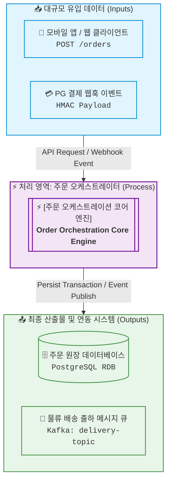
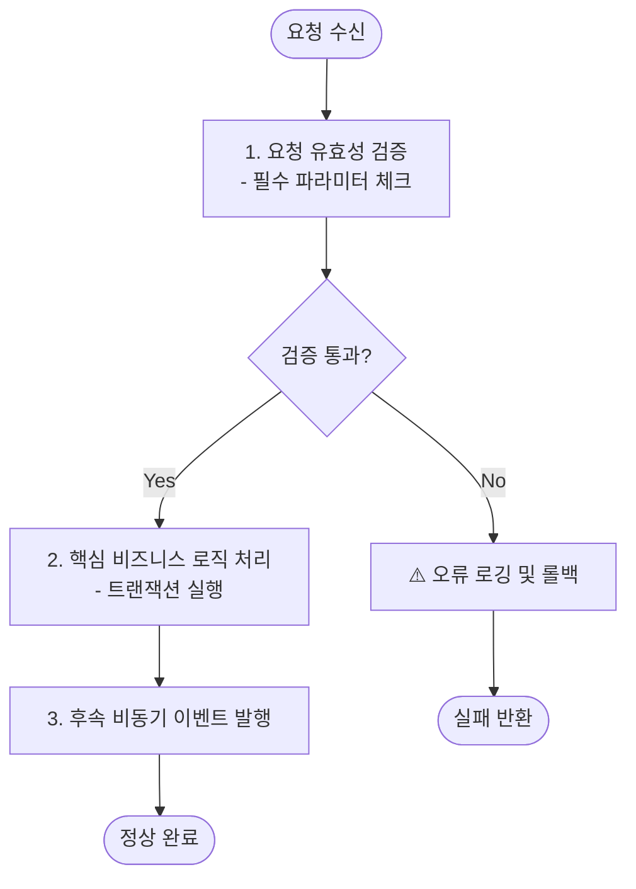
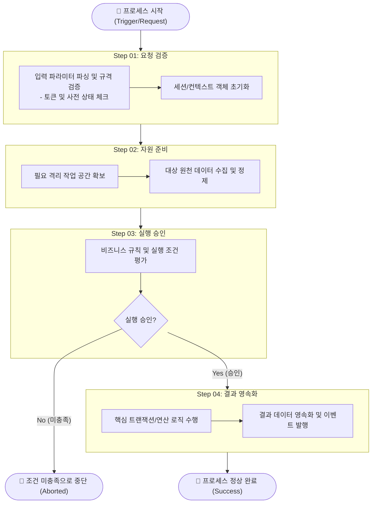
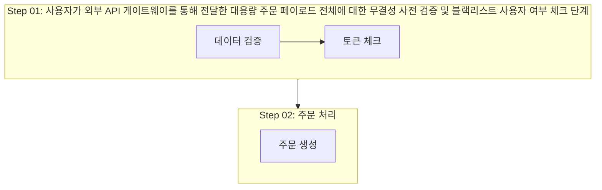
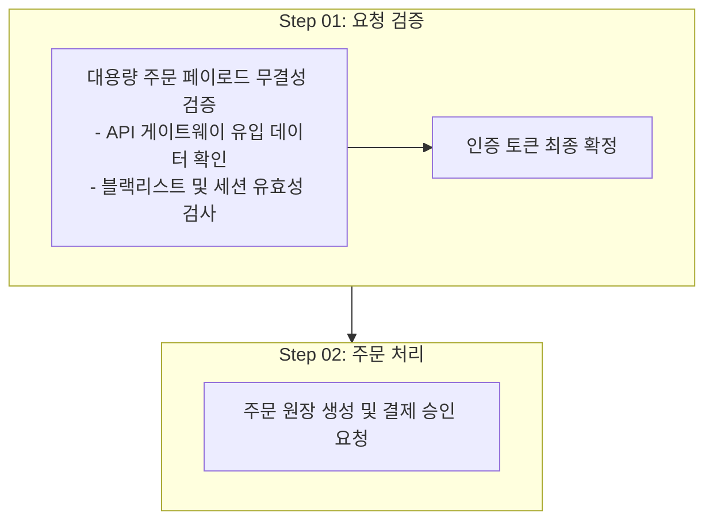

# 다이어그램 작성 표준 가이드 (Diagram Standardization)

시스템 아키텍처나 비즈니스 프로세스 흐름도를 시각화할 때 가독성을 극대화하고 Mermaid 렌더링 충돌(화살표-텍스트 겹침, 서브그래프 여백 왜곡)을 방지하며, 표준 디자인 요소 체계를 통해 일관된 의미를 전달하고, 생성된 다이어그램을 실무 이미지 자산으로 보존하기 위한 표준 지침입니다.

---

## 1. 스킬 적용 상황 및 발동 기준 (When to Use)

다음과 같은 상황에서 **사용자의 명시적 요청이 있거나, 에이전트가 자율적으로 필요성을 판단했을 때 반드시 이 스킬을 활성화**합니다:

### 🌟 0) 에이전트 자율 판단 트리거 (Proactive / Autonomous Trigger)
* **원칙**: 사용자가 직접 "그림 그려줘", "다이어그램 만들어줘"라고 말하지 않았더라도, 다음 상황에서는 **에이전트가 스스로 판단하여 능동적으로 다이어그램을 작성**하고 이 스킬을 적용합니다:
  1. **설계 및 계획 문서 작성 시**: 시스템 설계서(`artifacts/designs/`), 아키텍처 제안, 구현 계획서(`artifacts/plans/`) 작성 시 컴포넌트 간 상호작용 설명이 필요할 때.
  2. **복잡한 텍스트 설명의 시각화 보완**: 3단계 이상의 파이프라인, 트랜잭션 분기, 보상 로직(Saga)을 글로만 설명하면 복잡하여 이해도가 떨어질 때.
  3. **다중 I/O 관계 규명**: 여러 입력 소스와 여러 출력 타깃이 결합되어 텍스트 목록만으로는 데이터 흐름 파악이 어려울 때.

### 1) 시스템 및 기능 아키텍처 설계/문서화
* **상황**: 신규 서비스 구조 설계서, PRD, 기술 기획서, 아키텍처 설계서를 작성할 때.
* **적용**: 클라이언트, API 게이트웨이, 마이크로서비스, 데이터베이스, 외부 연동 시스템 간의 상호작용을 도식화할 때.

### 2) 대규모 데이터 파이프라인 및 배치/ETL 작업 시각화
* **상황**: 복수의 원천 데이터(Kafka 스트림, 로그 파일, 외부 API)를 수집·가공하여 여러 저장소(RDB, DW, 캐시)로 적재하는 파이프라인을 설명할 때.
* **적용**: 데이터 유입처(Input)와 분산 저장처(Output), 그리고 내부 연산 단계를 명확히 분리해야 할 때.

### 3) 1개 작업 내에 다단계(3개 이상) 하위 작업이 존재하는 프로세스
* **상황**: 단일 프로세스(예: 주문 처리, 결제 승인, 사용자 온보딩, 배치 작업) 내부에서 순차 검증, 병렬 처리, 조건 분기, 롤백(Saga 패턴)이 함께 일어날 때.
* **적용**: 하나의 서브그래프 박스 안에 모든 입출력과 세부단계를 쑤셔 넣어 선이 엉키는 것을 방지하기 위해 2계층 분리를 적용할 때.

### 4) 기존 다이어그램의 가독성 개선 및 리팩토링
* **상황**: 이미 작성된 다이어그램에서 "글자와 화살표가 겹친다", "노드가 너무 복잡해서 한눈에 안 들어온다", "레이아웃이 깨진다"는 피드백이 있을 때.
* **적용**: 단일 다이어그램을 Level 1과 Level 2로 쪼개고 Mermaid 레이아웃 수칙을 적용하여 가독성을 개선할 때.

---

## 2. 핵심 원칙: 2계층 분리 (Two-Level Separation)

명확한 Input/Output이 존재하고 내부에서 다단계 작업을 수행하는 시스템은 단일 다이어그램에 무리하게 서브그래프(Subgraph)로 통합하지 않고, **반드시 2단계 다이어그램으로 분리**하여 작성합니다.

### Level 1. 시스템 전체 조망도 (Integration & Context View)
* **목적**: 기획자, 외부 연동 팀, 비즈니스 이해관계자를 위한 거시적 인터페이스 및 I/O 조망.
* **형태**: `flowchart TD` (상 ➔ 하).
* **규칙**:
  1. 전체적인 정보 흐름(IPO: Input ➔ Processing ➔ Output)을 **위에서 아래(`flowchart TD`)**로 일관되게 배치합니다.
  2. 메인 처리 시스템은 세부 로직을 감춘 **단일 블랙박스 노드**(`[[...]]`) 또는 **처리 영역 서브그래프(`subgraph Process`)**로 정의합니다.
  3. 외부 Input 소스(API, 웹훅, 큐 등)와 최종 Output 대상(DB, 스토리지, 외부 통지 등)을 각각의 서브그래프(`subgraph Inputs`, `subgraph Outputs`)로 명확히 그룹화합니다.
  4. **서브그래프 타깃팅 연결 원칙 (Subgraph-Targeted Flow)**:
     - **단계 간 전환 화살표는 내부 세부 노드가 아닌 서브그래프 ID(단계 박스 자체)를 직접 가리켜야 합니다.**
     - 예: `Inputs --> Process`, `Process --> Outputs` (또는 `Inputs --> CoreEngine`, `CoreEngine --> Outputs`).
     - **서브그래프 내부 격리**: `Inputs`나 `Outputs` 내부의 개별 노드는 해당 영역 내부에서만 배치되며, 외부 단계의 세부 노드로 직접 선을 뻗지 않아 선 교차 및 텍스트 겹침을 원천 차단합니다.
  5. 필요 시 서브그래프 간 전환 연결선 위에 주요 프로토콜, 이벤트 명세 또는 데이터 포맷을 명시합니다 (`Inputs -- "API Request / Event" --> Process`).

### Level 2. 내부 세부 프로세스 흐름도 (Detailed Process Flow View)
* **목적**: 개발자, 아키텍트, 운영자를 위한 상세 구현 로직 및 예외 처리 흐름.
* **형태**: `flowchart TD` (상 ➔ 하).
* **규칙**:
  1. 외부 Input/Output 박스를 과감히 제거하고, **내부 실행 파이프라인**에만 집중합니다.
  2. 단계별 순차 작업, 병렬 처리, 유효성 검증, 조건 분기(`{...}`)를 표현합니다.
  3. 장애 대응 및 보상 트랜잭션(Rollback / Saga Pattern) 흐름을 명시합니다.
  4. **서브그래프 타깃팅 연결 원칙 (Subgraph-Targeted Flow)**:
     - 3단계 이상의 다단계 작업이 2개 이상의 서브그래프(`subgraph S1`, `subgraph S2`, ...)로 그룹화된 경우, **단계 간 전환 화살표는 내부 세부 노드가 아닌 서브그래프 ID(단계 박스 자체)를 직접 가리켜야 합니다.**
     - **시작 노드 진입**: `Start(["🚀 시작"]) --> S1` (첫 번째 단계 박스 자체를 가리킴)
     - **단계 간 전환**: `S1 --> S2`, `S2 --> S3` (이전 단계 박스 전체에서 다음 단계 박스 전체로 연결)
     - **서브그래프 내부 격리**: 각 서브그래프 내부 노드는 해당 단계 내의 로컬 순서(`P1 --> P2 --> P3`)만 연결하며, 외부 다른 단계의 세부 노드로 직접 선을 뻗지 않습니다.
     - **조건 분기 연결**: 서브그래프 내부의 조건/분기 노드에서 다음 단계로 분기할 경우 대상 서브그래프 ID로 직접 연결합니다 (`Check -- "Yes" --> S4`, `Check -- "No" --> Cancel`).
  5. **단계 박스 폭 대칭성 및 정렬 규칙 (Symmetry & Proportions)**:
     - 상하 인접한 단계 박스의 가로 너비가 극단적으로 차이나지 않도록 단계 제목과 내부 노드의 너비 비율을 균형 있게 맞춥니다.
     - 너비 차이가 극심하면 단계 전이 화살표(`S1 --> S2`)가 사선으로 심하게 꺾이거나 레이아웃 밸런스가 무너집니다.

---

## 3. 다이어그램 표준 디자인 요소 및 역할 체계 (Design Elements & Semantic Roles)

다이어그램의 시각적 완성도와 직관성을 극대화하기 위해 다음 디자인 요소를 엄격히 매핑하여 사용합니다:

| 구분 | 디자인 요소 / 문법 | 역할 및 시맨틱 의미 (Semantic Role) | 실무 적용 예시 |
| :--- | :--- | :--- | :--- |
| **노드 형태** | **알약형 / Stadium**<br/>`([ ... ])` | **프로세스 라이프사이클 경계**<br/>- 트리거 이벤트, 외부 시작점, 정상 완료, 중단점 | `Start(["🚀 주문 요청 수신"])`<br/>`End(["🏁 프로세스 완료"])` |
| | **직사각형**<br/>`[ ... ]` | **단위 작업 및 처리 로직 (Task/Step)**<br/>- 데이터 파싱, 단일 비즈니스 연산, 상태 변경 | `Task["데이터 유효성 검증"]` |
| | **이중 사각형**<br/>`[[ ... ]]` | **블랙박스 코어 엔진 / 서브시스템**<br/>- 내부 세부 로직이 캡슐화된 메인 오케스트레이터 | `Engine[["⚡ Core Engine"]]` |
| | **실린더 / 원통**<br/>`[( ... )]` | **데이터 영속화 스토리지 (Storage)**<br/>- 데이터베이스(RDB/NoSQL), 데이터 레이크, 캐시 | `DB[("🗄️ PostgreSQL DB")]` |
| | **마름모꼴**<br/>`{ ... }` | **의사결정 및 검증 분기 (Decision Gate)**<br/>- 조건 평가, 상태 분기 (최대 10자 이내 압축) | `Check{"재고 유효성 통과?"}` |
| | **서브그래프**<br/>`subgraph ID [...]` | **논리적 계층 및 실행 단계 (Container/Step)**<br/>- I/O 그룹핑, 다단계 프로세스 단계(`Step NN`) | `subgraph Inputs [...]`<br/>`subgraph S1 ["Step 01: 검증"]` |
| **연결선** | **기본 실선**<br/>`-->` / `--->` | **동기 순차 실행 및 메인 데이터 흐름** | `Step1 ---> Step2` |
| | **점선 화살표**<br/>`-.->` | **비동기 이벤트, 간접 의존성, 알림 발송** | `Step5 -.-> EventBus` |
| | **굵은 실선**<br/>`==>` | **크리티컬 패스 (핵심 트랜잭션 성공 흐름)** | `Auth ==> Payment` |
| | **선 라벨**<br/>`-- "텍스트" -->` | **통신 프로토콜, 페이로드 규격, 분기 조건** | `Check -- "Yes" --> Next` |
| **색상 팔레트** | **Soft Blue**<br/>`#e1f5fe / #0288d1` | **Input / 유입 영역**<br/>- 외부 요청, 수신 데이터, 클라이언트 | `classDef inputStyle ...` |
| | **Deep Purple/Gray**<br/>`#f3e5f5 / #7b1fa2` | **Core Process / 메인 처리 영역**<br/>- 중앙 오케스트레이터, 핵심 연산 엔진 | `classDef coreStyle ...` |
| | **Soft Green**<br/>`#e8f5e9 / #388e3c` | **Output / 정상 완료 산출물**<br/>- 최종 저장소, 성공 응답, 리포트 생성 | `classDef outputStyle ...` |
| | **Soft Red/Coral**<br/>`#ffebee / #d32f2f` | **Exception / 오류 및 보상 롤백**<br/>- 장애 처리, 트랜잭션 취소, 실패 통지 | `classDef errorStyle ...` |

---

## 4. Mermaid 가독성 및 렌더링 안정성 수칙

### 1) 텍스트 상자 오버플로우 방지 수칙 (Prevent Text Overflow & Clipping)
글자가 노드 테두리 바깥으로 삐져나오거나 잘리는 현상을 방지하기 위해 다음 4대 규칙을 엄격히 준수합니다:
* **한 줄 길이 제한 및 명시적 줄바꿈(`<br/>`)**:
  - 노드 텍스트는 1줄당 **한글 기준 15~18자**, **영문 기준 25~30자** 이내로 제한합니다.
  - 마크다운 렌더러의 자동 줄바꿈에 의존하지 말고, 의미 단위마다 반드시 `<br/>` 태그를 명시하여 텍스트 상자의 폭을 제어합니다.
* **노드 텍스트 전체 큰따옴표(`"..."`) 필수 래핑**:
  - `<br/>`, 괄호 `()`, 슬래시 `/`, 백틱, 공백 등이 포함된 모든 노드 텍스트는 반드시 큰따옴표로 감쌉니다.
  - ❌ `Node[긴 설명 (Detail)]` ➔ SVG Bounding Box 계산 오류로 글자 삐져나옴 발생
  - ⭕ `Node["긴 설명<br/>(Detail)"]` ➔ 파서가 안전하게 박스 크기를 텍스트에 맞춤
* **공백 없는 긴 식별자(URL, 경로, 변수명) 강제 분할**:
  - API 엔드포인트(`POST /api/v1/user/orders`), 파일 경로, 스네이크 케이스 식별자는 공백이 없어 브라우저가 개행하지 못합니다.
  - 반드시 구분자(`/`, `_`, `.`) 뒤에 `<br/>`를 강제 삽입하여 줄바꿈합니다 (예: `<code>/api/v1/<br/>user/orders</code>`).
* **마름모꼴 분기 노드(`{...}`) 텍스트 초압축**:
  - 마름모 노드는 사각형에 비해 상하좌우 모서리 면적이 좁아 텍스트가 좌우 테두리를 뚫고 나가기 매우 쉽습니다.
  - 조건 질문은 반드시 **1~2개 핵심 어절(최대 10자 이내)**로 압축합니다 (예: `{"검증 통과?"}`, `{"재시도 여부?"}`). 긴 조건 설명은 이전 작업 노드나 분기 선(`|Yes: 조건설명|`)에 기술합니다.

### 2) 서브그래프(단계 박스) 제목 및 내부 노드 균형 수칙 (Subgraph Title & Node Balance)
서브그래프(단계 박스)의 너비는 **"제목 텍스트 너비"**와 **"내부 노드 최대 너비"** 중 더 넓은 쪽에 맞춰 자동 결정됩니다. 한쪽만 비정상적으로 길어지는 불균형을 막기 위해 다음 수칙을 준수합니다:

* **단계 제목 공식 표준 (`Step NN: [핵심 역할/동사]`)**:
  - 서브그래프 제목은 반드시 **`Step NN: [핵심 역할/동사]`** 형태로 통일합니다 (예: `Step 01: 요청 검증`, `Step 02: 자원 준비`).
  - 제목 길이는 공백 포함 **한글 15~20자 이내**로 초압축합니다.
  - 서브그래프 헤더 영역은 브라우저/뷰어에 따라 `<br/>` 개행 태그가 무시되거나 한 줄로 강제 렌더링되는 환경이 많으므로, 긴 문장을 넣지 않고 단문 명사/동사형을 유지합니다.
  - 서브그래프 라벨은 반드시 큰따옴표로 감쌉니다 (`subgraph S1 ["Step 01: 요청 검증"]`).
* **상세 맥락의 내부 첫 번째 노드 이관 (Context Delegation Pattern)**:
  - 해당 단계의 복잡한 배경, 세부 목적, 처리 맥락은 서브그래프 제목에 장황하게 넣지 않고, 단계 내부의 **첫 번째 작업 노드(또는 안내 노드)**에 `<br/>`를 사용하여 서술합니다.
  - ❌ `subgraph S1 ["Step 01: 외부 유입 주문 데이터에 대해 인증 토큰 및 재고 가용성을 사전 검증하는 단계"]`
  - ⭕ `subgraph S1 ["Step 01: 요청 검증"]`  
    `    P1["유입 주문 데이터 유효성 검증<br/>- 인증 토큰 및 사전 재고 확인"]`
* **거대한 빈 공간(Dead Space) 방지 및 비율 밸런스**:
  - 내부 작업 노드는 작은데 제목만 길면 단계 박스가 좌우로 비대하게 확장되어 노드 주변에 광활한 Dead Space가 생기고, 다음 단계 박스와의 폭 불균형으로 연결선 왜곡이 발생합니다.
  - 반대로 제목은 짧은데 내부 노드가 1줄로 길어지면 내부 노드가 테두리를 뚫고 나가는 오버플로우가 발생합니다.
  - 따라서 내부 노드는 1줄당 한글 15~18자 이내로 `<br/>`를 강제하고, 제목은 15~20자 이내로 맞추어 상하 단계 박스들이 시각적으로 정갈한 사각형 비율을 유지하도록 합니다.

### 3) 레이아웃 및 연결선 최적화 수칙
1. **방향 혼용 금지**:
   * 최상위와 서브그래프 간에 `direction LR`과 `direction TB`를 중첩 혼용하지 않습니다.
2. **서브그래프 중첩 단순화**:
   * 서브그래프 내부에 또 다른 서브그래프를 중첩하는 것을 지양합니다.
3. **서브그래프 간 직접 연결 활용**:
   * 다단계 작업 그룹화 시, 내부 노드에서 다음 서브그래프의 내부 세부 노드로 화살표를 꽂지 않고, 서브그래프 ID 간 직접 연결을 사용하여 상위 단계 흐름의 가독성을 극대화합니다:
     - Level 1: `Inputs --> Process`, `Process --> Outputs`
     - Level 2: `Start --> S1`, `S1 --> S2`, `Check --> S4`
4. **연결선 간격 확보**:
   * 분기가 복잡한 경우 `-->` 대신 `--->`를 사용하여 노드 간 물리적 여백을 확보합니다.

---

## 5. 표준 실무 템플릿 예시

### [Level 1 예시: 상->하(TD) 및 서브그래프 ID 직접 타깃팅 템플릿]


### [Level 2-A: 단일/선형 프로세스 템플릿]


### [Level 2-B: 다단계 그룹화 및 단계 박스 연결 템플릿 (권장)]


### [Level 2-C: 안티패턴(Anti-Pattern) vs 표준 베스트 프랙티스 비교]

#### ❌ 안티패턴: 제목이 과도하게 길어 Dead Space와 선 왜곡 발생


#### ⭕ 표준 베스트 프랙티스: 제목 압축 및 세부 설명 내부 첫 노드 이관


---

## 6. 다이어그램 이미지 파일 저장 및 자산화 규칙 (Image Export & Assetization)

다이어그램이 포함된 계획서, 설계서, 보고서를 작성할 때 시각화 산출물의 보존성과 외부 활용성을 높이기 위해 **다이어그램을 고해상도 이미지 파일로 저장하고 인덱스에 등록**해야 합니다.

### 1) 이미지 저장 표준 규격
* **저장 위치**: 실무 이미지 자산 전용 저장소인 [`agy_outputs/images/`](file:///c:/work_dir/my_agy/agy_outputs/images)
* **파일명 명명 규칙**: `image_([주제명])_[YYMMDD].png`
  - 하이픈(`-`) 사용 금지, 언더스코어(`_`)만 사용
  - 주제명은 소괄호 `(` `)`로 직접 감쌈
  - 날짜는 6자리 `YYMMDD` 표기 (필요 시 `_rev[NN]` 버전 표기)
  - 예시: `agy_outputs/images/image_(order_process_flow)_261007.png`
* **인덱스 동기화 의무**:
  - 생성된 이미지는 즉시 [`agy_outputs/README.md`](file:///c:/work_dir/my_agy/agy_outputs/README.md) 인덱스 테이블에 등록합니다:
    ```markdown
    | 일자 | 카테고리 | 주제/설명 | 파일명 (링크) |
    | :--- | :--- | :--- | :--- |
    | 261007 | image | 주문 처리 세부 흐름도 | [image_(order_process_flow)_261007.png](images/image_(order_process_flow)_261007.png) |
    ```

### 2) 내장 유틸리티 스크립트 실행 가이드 (`save_diagram_image.py`)
`diagram-standard` 스킬에는 무설치 Python 표준 라이브러리(`urllib`, `base64`) 기반의 렌더링 및 인덱스 갱신 스크립트가 내장되어 있습니다.

* **스크립트 경로**: `diagram-standard/scripts/save_diagram_image.py`
* **주요 사용법**:
  ```bash
  # 1. 파일에 작성된 Mermaid 다이어그램을 PNG로 내보내기 (권장)
  python diagram-standard/scripts/save_diagram_image.py --topic "order_flow" --desc "주문 처리 프로세스 흐름도" --code-file "path/to/diagram.mmd"

  # 2. 인라인 코드로 직접 내보내기
  python diagram-standard/scripts/save_diagram_image.py --topic "order_flow" --desc "주문 처리 프로세스 흐름도" --code "flowchart TD..."

  # 3. SVG 포맷으로 내보내기 (agy_outputs/plots/ 저장)
  python diagram-standard/scripts/save_diagram_image.py --topic "order_flow" --format svg
  ```
* **동작 흐름**:
  1. 입력된 Mermaid 문법 코드 추출 및 검증
  2. 원격 렌더링 엔드포인트를 통한 무설치 고해상도 이미지(PNG/SVG) 바이너리 수신
  3. 규격에 맞춘 파일명으로 `agy_outputs/images/`에 안전 저장
  4. `agy_outputs/README.md` 인덱스 테이블 자동 파싱 및 신규 레코드 등록
