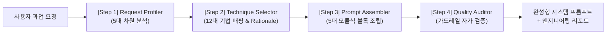

# 메타프롬프팅 스킬 (`meta-prompting`)

본 스킬은 사용자의 과업 요구사항을 체계적으로 분석하여, **12대 주요 프롬프팅 기법** 중 최적의 기법 조합을 선정하고 완성도 높은 **프로덕션 레벨의 시스템 프롬프트(System Prompt)를 자동 조립·검증**하는 전문 엔지니어링 파이프라인을 제공합니다.

---

## 1. 아키텍처 개요 (Architectural Overview)

메타프롬프팅 파이프라인은 4단계의 순차적 모듈로 구성됩니다:



### 4대 핵심 모듈
1. **Request Profiler**: 사용자 입력을 5대 차원(추론 깊이, 도구 의존성, 포맷 엄격성, 위험도, 지연 시간)으로 구조화.
2. **Technique Selector**: `references/decision_matrix.md` 기반으로 1차(Primary) 및 보조(Secondary) 기법 도출 및 선정 근거 제시.
3. **Prompt Assembler**: `references/prompt_components.md` 라이브러리를 활용하여 5대 블록(Role, Task, Tools, Guardrails, Output & Few-shot)을 조립.
4. **Quality Auditor**: 생성된 프롬프트의 지침 준수율, 환각 방지, 보안 가드레일을 자가 진단(Self-Refine).

---

## 2. 4단계 실행 워크플로 (Execution Workflow)

본 스킬이 트리거되면 에이전트는 다음 4단계를 차례로 수행합니다.

### Step 1: 사용자 요청 다차원 프로파일링 (Request Profiling)
사용자가 제공한 자연어 요구사항, 목표, 입출력 데이터를 분석하여 다음 5대 차원 매트릭스를 평가합니다:

| 분석 차원 | 평가 척도 | 정의 및 판단 기준 |
| :--- | :--- | :--- |
| **1. 추론 깊이 (Reasoning Depth)** | `Low` / `Medium` / `High` | 단순 요약/포맷팅(`Low`), 비즈니스 룰/다단계 연산(`Medium`), 복합 알고리즘/수학/기호 논리(`High`) |
| **2. 도구 의존성 (Tool Dependency)** | `None` / `Single` / `Multi-Agent` | 모델 자체 지식(`None`), 검색/DB/API 연동(`Single`), 복수 서브에이전트 조율(`Multi-Agent`) |
| **3. 포맷 엄격성 (Schema Strictness)** | `Free-form` / `Semi-structured` / `Strict JSON/XML` | 일반 서술형(`Free-form`), 마크다운 표/문서(`Semi`), 엄격한 JSON Schema 파싱(`Strict`) |
| **4. 위험도 및 신뢰성 (Stakes & Error Tolerance)** | `Low` / `Medium` / `High-Stakes` | 창의적 글쓰기(`Low`), 사내 일반 업무(`Medium`), 금융/의료/보안/규제 오답 치명 과업(`High-Stakes`) |
| **5. 지연 시간 제약 (Latency Sensitivity)** | `Real-time (<3s)` / `Standard (<15s)` / `Batch/Async` | 실시간 챗봇(`Real-time`), 일반 상호작용(`Standard`), 심층 백서/대용량 데이터 배치(`Batch`) |

#### 내부 JSON 구조체 예시
```json
{
  "reasoning_depth": "High",
  "tool_dependency": "Single",
  "schema_strictness": "Strict JSON",
  "stakes": "High-Stakes",
  "latency_sensitivity": "Standard"
}
```

---

### Step 2: 최적 프롬프팅 기법 선택 (Technique Selection)
`references/decision_matrix.md`의 의사결정 규칙과 상충 해결 매트릭스를 적용하여 최적의 조합을 산출합니다.

1. **도구 및 환경 상호작용**:
   - 외부 API/DB/Shell 연동 필요 $\rightarrow$ `ReAct` 채택 (실패 복구 필요 시 `Reflexion` 결합).
2. **복합 과업 구조 분해**:
   - 거대 파이프라인/단일 책임 분리 $\rightarrow$ `Prompt Chaining` 채택.
   - 선행 단계 해가 후행 단계의 입력이 되는 순차 의존 과업 $\rightarrow$ `Least-to-Most` 채택.
3. **추론 깊이 및 신뢰성 보증**:
   - 복합 수학/알고리즘/논리 $\rightarrow$ `Chain-of-Thought (CoT)` 채택.
   - 오답 위험이 치명적인 고위험 과업(High-Stakes) $\rightarrow$ `CoT + Self-Consistency (CoT-SC)` 다수결 투표 결합.
   - 다각도 대안 탐색 및 백트래킹 필요 $\rightarrow$ `Tree of Thoughts (ToT)` 채택.
4. **지연 시간 및 대규모 텍스트 생성**:
   - 장문 보고서의 초고속(Low Latency) 작성 $\rightarrow$ `Skeleton-of-Thought (SoT)` 채택.
5. **특수 지식 및 포맷 통제**:
   - 반직관적 상식/전문 지식 $\rightarrow$ `Generated Knowledge` 채택.
   - 특정 키워드/인물 집중 $\rightarrow$ `Directional Stimulus (DSP)` 채택.
   - 엄격한 스키마/특수 사내 규격 $\rightarrow$ `Synthetic Few-shot` 2쌍 이상 주입.
6. **상충 요구조건 해결 (Conflict Resolution)**:
   - 복합 상충 시(예: 도구 연동 + 고위험 추론, 고정밀 심사 + 초저지연) `references/decision_matrix.md` Section 5의 계층 분할(Tiered) 또는 하이브리드 패턴(Pattern D)을 적용하여 트레이드오프를 해소합니다.

> **출력 의무**: 반드시 **Primary 기법**, **Secondary 결합 기법**, 그리고 **선정 근거(Rationale)**를 명시해야 합니다.

---

### Step 3: 모듈식 프롬프트 조립 (Prompt Assembly)
`references/prompt_components.md`의 5대 표준 블록 템플릿을 조합하여 최종 시스템 프롬프트를 렌더링합니다:

1. **Block A (Role & Persona)**: 명확한 도메인 정체성, 전문성 연차, 사고방식 정의.
2. **Block B (Task Instructions & Thinking Protocol)**: 
   - CoT 적용 시: "단계별 사고 전개(Step-by-step reasoning)" 규칙 내장.
   - Least-to-Most 적용 시: "하위 문제 분해 및 점진적 해결 절차" 명시.
   - SoT 적용 시: "골격 목차 선행 생성 후 병렬 전개" 지침 명시.
   - ToT 적용 시: "생각 분기 생성, 상태 평가, 백트래킹" 프로토콜 명시.
   - DSP 적용 시: "자극 힌트 기반 집중 유도" 지침 명시.
   - Chaining 적용 시: "단계별 단일 책임 및 검증 게이트웨이" 명시.
3. **Block C (Tool Protocols & Interaction)**: 
   - ReAct 적용 시: `Thought` $\rightarrow$ `Action` $\rightarrow$ `Observation` 프로토콜 규격화.
   - Reflexion 적용 시: 에러 발생 시 언어적 반성(`Verbal Reflection`) 및 대체 액션 재시도 지침 결합.
4. **Block D (Constraints & Guardrails)**:
   - 긍정형 제약 명세, 환각(Hallucination) 방지 지침, 입력 데이터 외 추측 금지, 탈옥(Jailbreak) 방어, XML 태그 구분자(` <user_input> `) 격리.
5. **Block E (Output Schema & Synthetic Few-shots)**:
   - 대상 과업 도메인에 부합하는 가상의 입력-출력 쌍(Few-shot)을 **표준 2쌍 이상**(정상 케이스 1건 + 엣지/오류복구 케이스 1건) 자율 합성하여 포함.
   - CoT-SC 적용 시 다수결 투표 추출용 태그 규격(`<verdict>`) 명시.

---

### Step 4: 품질 감사 및 가드레일 자가 검증 (Quality Audit)
생성된 프롬프트를 사용자에게 전달하기 전, 다음 5개 자가 진단 질문을 체크합니다:

- [ ] **지침 명확성 (Clarity)**: 모호한 수식어 없이 측정 가능한 행동 지침으로 작성되었는가?
- [ ] **환각 억제 (Anti-Hallucination)**: 모르는 정보나 컨텍스트 부재 시 솔직히 인정하거나 검색하도록 제약이 설정되었는가?
- [ ] **구분자 격리 (Delimiters)**: 입력 데이터와 지침이 XML 태그 또는 Markdown 헤더로 명확히 분리되었는가?
- [ ] **Few-shot 정합성 (Example Alignment)**: 합성된 예시가 요구된 출력 스키마와 완벽히 일치하는가?
- [ ] **보안 가드레일 (Safety & Jailbreak)**: 시스템 프롬프트 유출 시도나 악의적 명령 무시 규칙이 포함되었는가?

---

## 3. 최종 사용자 응답 포맷 (Deliverable Output Standard)

본 스킬 실행 시 최종 응답은 반드시 다음 형식을 갖추어 출력합니다:

````markdown
# [메타프롬프트 엔지니어링 결과 보고서]

## 1. 과업 요구사항 다차원 분석 (Task Profile)
- **추론 깊이 (Reasoning Depth)**: [Low / Medium / High]
- **도구 의존성 (Tool Dependency)**: [None / Single / Multi-Agent]
- **포맷 엄격성 (Schema Strictness)**: [Free-form / Semi-structured / Strict JSON]
- **위험도 및 신뢰성 (Stakes)**: [Low / Medium / High-Stakes]
- **지연 시간 제약 (Latency Sensitivity)**: [Real-time / Standard / Batch]

## 2. 선정된 최적 프롬프팅 기법 (Technique Selection)
- **Primary 기법**: [예: ReAct]
- **Secondary 기법**: [예: Few-shot + Reflexion]
- **엔지니어링 선정 근거 (Rationale)**: 
  - [선택 이유 1]
  - [선택 이유 2]

## 3. 완성형 프로덕션 시스템 프롬프트 (Production System Prompt)
> 아래 코드 블록의 내용을 복사하여 시스템 프롬프트 또는 에이전트 지침으로 즉시 사용하세요.

```markdown
[생성된 시스템 프롬프트 전문]
```

## 4. 실행 및 연동 가이드라인 (Usage Guidelines)
- **권장 모델 및 파라미터**: [예: Temperature: 0.2, Top-P: 0.95]
- **도구 바인딩 규격**: [도구 호출 시 주의사항]
- **런타임 팁**: [프롬프트 운영 시 유의사항]

## 5. 품질 감사 및 가드레일 검증표 (Quality Audit)
- [x] 지침 명확성 (Clarity & Actionability) 통과
- [x] 환각 방지 및 컨텍스트 격리 (Grounding) 통과
- [x] 스키마 정합성 (Schema Strictness) 통과
- [x] 시스템 보안 가드레일 (System Guardrails) 통과
````

---

## 4. 참조 문서 및 실전 예시

- 상세 기법 선택 규칙 및 매트릭스: [decision_matrix.md](references/decision_matrix.md)
- 5대 모듈식 블록 템플릿 라이브러리: [prompt_components.md](references/prompt_components.md)
- 도구 연동형 에이전트 실전 케이스: [case_agentic_bot.md](examples/case_agentic_bot.md)
- 초고속 장문 분석 실전 케이스: [case_analytical_report.md](examples/case_analytical_report.md)
- 고위험 정밀 심사 실전 케이스: [case_high_stakes_eval.md](examples/case_high_stakes_eval.md)
