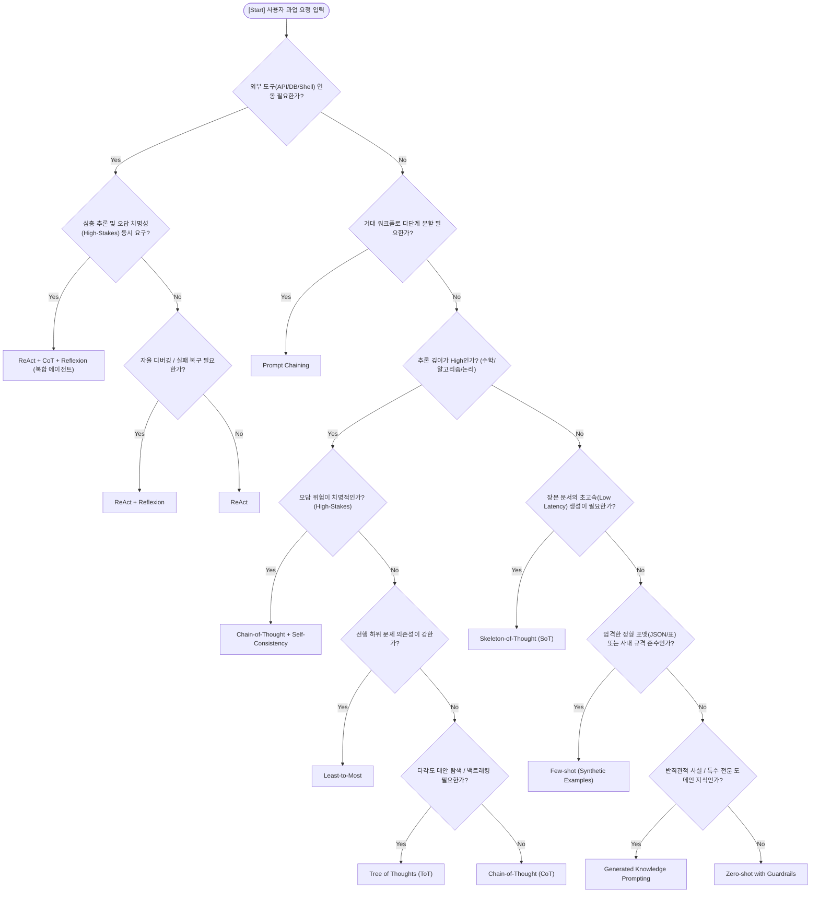

# 프롬프팅 기법 선택 의사결정 매트릭스 (Technique Decision Matrix)

본 문서는 사용자의 과업 요구사항을 5대 차원으로 정량 분석하고, 이를 바탕으로 **12대 주요 프롬프팅 기법 중 최적의 기법 조합을 체계적으로 도출**하기 위한 엔지니어링 판단 기준표입니다.

---

## 1. 사용자 요청 분석 5대 차원 평가 기준 (5-Dimension Evaluation Criteria)

| 차원 (Dimension) | 등급 (Level) | 정량/정성 판정 기준 | 대표 과업 예시 |
| :--- | :--- | :--- | :--- |
| **1. 추론 깊이**<br>*(Reasoning Depth)* | **Low** | 단일 단계 처리, 단순 텍스트 변환, 정보 재배열, 기본 문법 교정 | 단순 영한 번역, 감성 2분류, 텍스트 요약 |
| | **Medium** | 2~3단계의 비즈니스 규칙 판정, 조건부 데이터 필터링 | 사내 규정 조회 후 적합성 판단, SQL 쿼리 생성 |
| | **High** | 4단계 이상의 복합 수리 연산, 알고리즘 구현, 논리적 인과 추론, 다변수 최적화 | 이상 거래 탐지, 버그 근본원인 분석, 수학 증명 |
| **2. 도구 의존성**<br>*(Tool Dependency)* | **None** | 모델의 파라메트릭 지식과 제공된 정적 프롬프트만으로 완결 | 일반 창작, 기획서 초안, 정적 문서 번역 |
| | **Single** | 1~2개의 고정 외부 도구(웹 검색, 날씨 API, 단일 DB) 호출 필요 | 실시간 뉴스 브리핑, 고객 주문 상태 조회 |
| | **Multi-Agent** | 복수 시스템 제어, 파일 시스템 읽기/쓰기, 쉘 명령어 실행, 다중 에이전트 조율 | 완전 자율 코딩 에이전트, 장애 자동 복구 봇 |
| **3. 포맷 엄격성**<br>*(Schema Strictness)* | **Free-form** | 자연어 서술, 유연한 산문 형태, 문체와 내용의 창의성이 우선 | 소설/시 창작, 자유 대화, 아이디어 발산 |
| | **Semi-structured** | 글머리 기호, 마크다운 헤더, 표(Table) 등 가독성을 위한 구조화 | 기술 보고서, 회의록 요약, 제품 비교표 |
| | **Strict JSON/XML** | 다운스트림 시스템 파싱용 엄격한 스키마(JSON, CSV, Pydantic, XML) 필수 | API 응답 생성, DB 엔티티 추출, 자동화 파이프라인 |
| **4. 위험도 및 신뢰성**<br>*(Stakes & Error Tolerance)* | **Low** | 오답 발생 시에도 시스템 영향 없음, 사용자 재미 및 참고용 | 유머 생성, 마케팅 문구 브레인스토밍 |
| | **Medium** | 내부 업무 보조, 인간 검토자(Human-in-the-loop)가 2차 검수 | 사내 보고서 초안, 일반 이메일 초안 작성 |
| | **High-Stakes** | 환각이나 계산 착오가 금전적 손실, 보안 사고, 법적 위반을 초래 | 세무/회계 감사, 의료 진단 보조, 금융 결제 처리 |
| **5. 지연 시간 제약**<br>*(Latency Sensitivity)* | **Real-time** | 사용자 체감 대기시간 3초 이내 필수, 상호작용 속도 극대화 | 고객 응대 라이브 챗봇, 자동완성 제안 |
| | **Standard** | 5~20초 수준의 통상적인 인터랙션 허용 | 일반 질의응답, 코드 리뷰, 사내 문서 질의 |
| | **Batch/Async** | 30초~수 분 이상 소요되어도 상관없음, 결과의 깊이와 완결성 최우선 | 수십 페이지 전략 보고서, 대규모 코드 리팩토링 |

---

## 2. 12대 프롬프팅 기법 선택 휴리스틱 매트릭스 (Technique Heuristics Matrix)

각 기법의 특성과 5대 차원 평가 결과에 따라 **1차 권장 기법(Primary)**과 **결합 권장 기법(Secondary)**을 매핑합니다:

| 요구 조건 및 과업 특성 | 1차 권장 기법 (Primary) | 결합 권장 기법 (Secondary) | 선정 근거 (Rationale) 및 런타임 권장 파라미터 |
| :--- | :--- | :--- | :--- |
| **외부 도구(API, DB, Shell) 제어 필수** | **ReAct** | **Reflexion** | 외부 환경 조작 시 예외 및 실패가 빈번하므로 `Thought-Action-Observation` 루프에 언어적 자가 반성을 결합하여 자동 복구.<br>*(Temp: 0.1~0.3)* |
| **복합 수리 연산, 정밀 기호 논리 추론** | **Chain-of-Thought (CoT)** | **Self-Consistency (CoT-SC)** | 중간 추론 단계를 강제하여 논리 비약을 차단하고, 독립 샘플 다수결 투표(N=5~10)로 우발적 계산 착오를 통계적으로 필터링.<br>*(Temp: 0.7, Samples: 5~10)* |
| **순차적 전제 조건 및 다단계 의존성 과업** | **Least-to-Most** | **Chain-of-Thought** | 복잡한 문제를 최소 단위 하위 질문으로 분해(Decomposition)하여 인지 과부하를 방지하고 단계별 정답을 누적 전진.<br>*(Temp: 0.2~0.4)* |
| **다각도 대안 탐색, 퍼즐, 게임, 전략 수립** | **Tree of Thoughts (ToT)** | **Prompt Chaining** | 생각의 분기를 생성·평가하고 막다른 길 봉착 시 역추적(Backtracking)을 수행하여 단일 경로의 조기 수렴 오류 방지.<br>*(Temp: 0.5~0.7)* |
| **엄격한 JSON/특수 규격 포맷 준수** | **Few-shot** | **Zero-shot with Guardrails** | 규칙 서술만으로는 누락되는 엣지 케이스를 방지하기 위해 도메인 맞춤형 입력-출력 예시(Synthetic Few-shot) 2쌍 이상 주입.<br>*(Temp: 0.0~0.2)* |
| **장문(수천 자 이상) 문서의 초고속 작성** | **Skeleton-of-Thought (SoT)** | **Prompt Chaining** | 토큰 순차 생성 병목을 해소하기 위해 1단계로 골격 목차를 신속 도출한 뒤 각 장을 비동기 병렬 LLM 호출로 채워 지연시간 70% 단축.<br>*(Temp: 0.4~0.6)* |
| **코드 생성, 유닛 테스트 자동 통과** | **Reflexion** | **ReAct** | 실행 실패 로그(Traceback)를 읽고 구체적인 언어 반성문(Verbal Reflection)을 생성하여 패치 코드를 자율 수정.<br>*(Temp: 0.2)* |
| **반직관적 상식, 특수 전문 도메인 팩트 QA** | **Generated Knowledge** | **Chain-of-Thought** | 외부 검색 없이도 관련 배경 원칙과 사실 지식을 사전 인출(Recall)하여 컨텍스트에 주입함으로써 파라메트릭 환각 원천 억제.<br>*(Temp: 0.3)* |
| **거대 엔터프라이즈 업무 다단계 파이프라인** | **Prompt Chaining** | **ReAct** | 단일 프롬프트 내 지침 희석(Instruction Drift)을 방지하고 각 단계마다 단일 책임(SRP) 부여 및 검증 게이트웨이 배치.<br>*(Temp: 0.2)* |
| **특정 관점/키워드 중심 맞춤형 요약** | **Directional Stimulus (DSP)** | **Few-shot** | 경량 정책 신호(자극 힌트)를 프롬프트에 주입하여 장문 텍스트 중 원하는 타깃 영역으로 모델의 집중도를 정밀 유도.<br>*(Temp: 0.3)* |
| **상충되는 다중 소스 데이터 종합/교차 검증** | **Graph of Thoughts (GoT)** | **Self-Consistency** | 비순환 방향 그래프(DAG) 형태로 이종 노드를 모델링하여 상충 데이터를 병합(Aggregation)하고 다수결로 신뢰도 검증.<br>*(Temp: 0.3~0.5)* |
| **보편적 상식, 단순 질의응답 및 기초 번역** | **Zero-shot** | **명확한 제약 가드레일** | 예시 주입에 따른 토큰 낭비 없이 명확한 역할과 제약 조건만으로 신속하고 경제적인 결과 도출.<br>*(Temp: 0.3~0.5)* |

---

## 3. 의사결정 분기 트리 (Decision Flowchart)



---

## 4. 실무 하이브리드 조합 패턴 사전 (Production Hybrid Patterns)

1. **Pattern A: 자율 에이전트 패턴 (The Autonomous Agent)**
   - 조합: `ReAct` + `Synthetic Few-shot` + `Reflexion`
   - 적합: 슬랙 봇, GitHub 이슈 해결 봇, 사내 DB 조회 및 변경 처리기.
2. **Pattern B: 초고속 전문 문서 생성기 (Fast Document Generator)**
   - 조합: `Prompt Chaining` + `Skeleton-of-Thought` + `Generated Knowledge`
   - 적합: 신규 사업 기획서, 기술 백서, M&A 실사 보고서, 컨설팅 보고서.
3. **Pattern C: 무결점 고위험 심사기 (Mission-Critical Auditor)**
   - 조합: `Least-to-Most` + `Chain-of-Thought` + `Self-Consistency`
   - 적합: 세무/회계 감사 전표 점검, 법률 계약서 리스크 스크리닝, 의료 연구 데이터 유효성 검증.
4. **Pattern D: 복합 수리 도구 에이전트 (Mission-Critical Tool Agent)**
   - 조합: `ReAct` + `Chain-of-Thought` + `Self-Consistency` + `Reflexion`
   - 적합: 외부 금융 DB 조회와 동시에 정밀 수리 계산 및 이상 징후 교차 감사를 수행하는 종합 에이전트.

---

## 5. 상충 요구사항 해결 및 트레이드오프 매트릭스 (Trade-off & Conflict Resolution Guide)

실무 프롬프트 엔지니어링에서는 5대 차원 간의 상충(Trade-off)이 빈번하게 발생합니다. 본 가이드는 충돌 시 우선순위 및 해결 전략을 규정합니다:

| 상충 시나리오 | 충돌 차원 | 엔지니어링 트레이드오프 분석 | 우선순위 및 표준 해결 전략 (Resolution Strategy) |
| :--- | :--- | :--- | :--- |
| **고정밀 심사 vs 초저지연** | `High-Stakes`<br>vs<br>`Real-time Latency` | CoT-SC(다수결 N=5~10)는 정확도를 보장하나 지연시간이 3~10배 증가하여 실시간 상호작용과 충돌 | **계층 분할(Tiered Architecture) 전략 채택**:<br>1단계: 경량 모델의 Zero-shot/CoT로 95%의 명확한 케이스를 1초 내 처리.<br>2단계: 신뢰도 점수(Confidence) 임계치 미달 건만 비동기 큐로 넘겨 CoT-SC 정밀 심사 수행. |
| **도구 연동 vs 엄격한 스키마** | `Tool Dependency`<br>vs<br>`Strict JSON Schema` | ReAct의 `Thought-Action-Observation` 비정형 텍스트 로그가 최종 정형 JSON 스키마를 오염시킬 위험 | **JSON-in-ReAct 격리 전략 채택**:<br>`Action` 인자와 `Final Answer`를 엄격한 단일 JSON 블록(` ```json ... ``` `)으로 명확히 구분하고, 파서가 마지막 JSON 블록만을 최종 결과로 추출하도록 가드레일 정의. |
| **초고속 병렬 vs 문맥 일관성** | `Skeleton-of-Thought`<br>vs<br>`Coherence / Context` | SoT 병렬 생성 시 각 챕터가 독립 실행되어 용어 불일치나 내용 중복/충돌 발생 위험 | **Chaining 결합 3단계 게이트웨이 전략 채택**:<br>Phase 1에서 공통 용어집/핵심 메시지 동시 배포 $\rightarrow$ Phase 2 병렬 생성 $\rightarrow$ Phase 3 통합 Aggregator 프롬프트에서 전후 문맥 및 어휘 정합성 검수. |
| **다단계 복합 추론 vs 토큰 예산** | `Least-to-Most`<br>vs<br>`Token Budget` | 하위 문제를 순차 해결하며 컨텍스트가 누적되어 컨텍스트 윈도우 소모 및 API 비용 급증 | **슬라이딩 서머리(Sliding Summary) 전략 채택**:<br>이전 하위 문제의 전체 추론 과정을 넘기지 않고, 다음 단계 해결에 직결되는 '핵심 결론 1문장(Key Result)'만을 추출하여 다음 프롬프트에 주입. |

